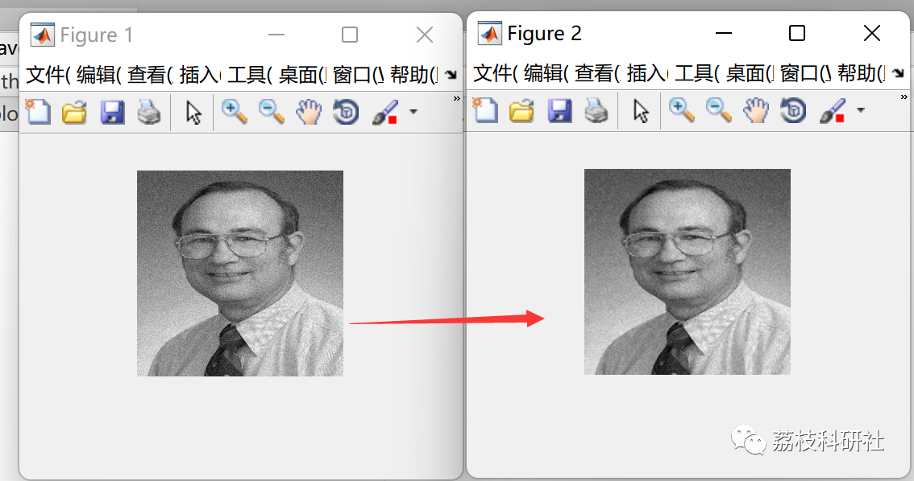
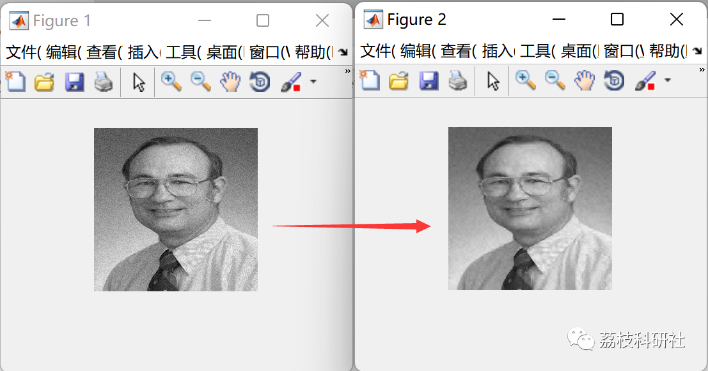

# Wavelet Transform-based Image Denoising (Matlab Code Implementation)

1. Overview
Generally speaking, real-world images are noisy, and noise in images significantly impacts image analysis and image compression. Therefore, it is essential to preprocess the image for subsequent higher-level processing. In recent years, wavelet theory has rapidly developed, and due to its excellent time-domain localization capabilities and multiresolution analysis abilities, it has been widely applied in various fields of image processing.
2. Running results
3. Matlab code
close all  
clear  
clc  
a3=imread('1','jpg');  
a2=rgb2gray(a3);  
b=imresize(a2,[256 256]);  
b=double(b)+40*rand(size(b));  
[a1,b1,c1,d1]=dwt2(b,'db2');  
v1=(median(abs(b1(:)))/0.6745);  
b1= wthresh(b1,'s',v1);  
v2=(median(abs(c1(:)))/0.6745);  
c1= wthresh(c1,'s',v2);  
v3=(median(abs(d1(:)))/0.6745);  
d1= wthresh(d1,'s',v3);  
c=idwt2(a1,b1,c1,d1,'db2');  
imshow(b,[])  
figure,imshow(c,[])  
r = snrr(double(b), c)  
Click the "Read More" button at the bottom left of this article to view the complete code.
Or reply with the keyword: Image Denoising Based on Wavelet Transform
4. References
[1] Zhang Xin, Zhang Dinghui, Li Xinxin, Zhang Jinping. Research on Image Denoising Based on Wavelet Transform [J]. Journal of Instrumentation and Control, 2006(z3): 2284-2286

## Images

<!-- PAYMENT_BLOCK -->

## Get this dataset

- Payment link (Stripe): [Buy now](https://buy.stripe.com/3cs8yP7sY87d0vu9AB)
- Payment QR code: 

<!-- /PAYMENT_BLOCK -->
